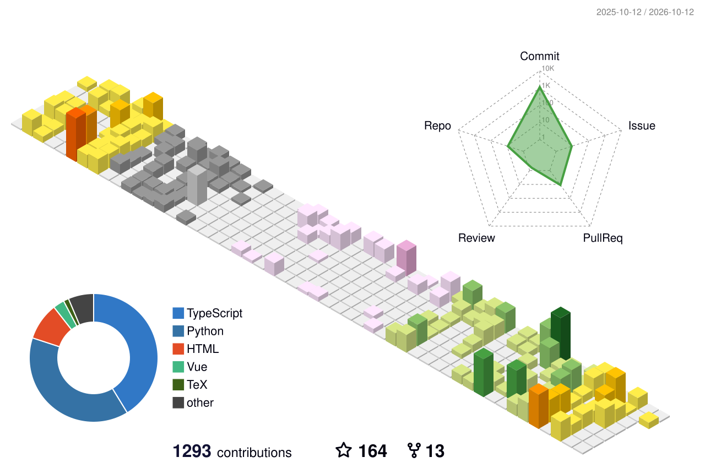

 

## About

- 来自湖北，现居深圳

- GZHU 27届 大数据专业 校招求职中 ⟶ [简历](./assets/前端简历_reconstructed_compressed.pdf)

- Github https://github.com/zhongye1

- 博客 https://blog.junce.net/

- Email 2760913192@qq.com

- Wechat

## Technology Stack

## 📈 GitHub Stats

## 友情组织

https://github.com/Guangzhou-University-SITE-193
/ Open Source Organization from GZHU

---

## 博客

欢迎添加友链：https://blog.junce.net/

<table>
  <thead>
    <tr>
      <th align="left">最新文章</th>
      <th align="center" width="120px">发布日期</th>
      <th align="center" width="100px">跳转链接</th>
    </tr>
  </thead>
  <tbody>
<!-- BLOG-POST-LIST:START --><tr><td>再谈操作系统 Vol.7 - 设备管理与 I/O</td><td align="center">2026-10-20</td><td align="center"><a href="https://blog.junce.net/blog/%E6%93%8D%E4%BD%9C%E7%B3%BB%E7%BB%9F/%E5%86%8D%E8%B0%88%E6%93%8D%E4%BD%9C%E7%B3%BB%E7%BB%9F-vol.7-%E8%AE%BE%E5%A4%87%E7%AE%A1%E7%90%86%E4%B8%8E-i-o/">点击阅读</a></td></tr>
<tr><td>再谈操作系统 Vol.6 - 文件系统与 Page Cache</td><td align="center">2026-10-20</td><td align="center"><a href="https://blog.junce.net/blog/%E6%93%8D%E4%BD%9C%E7%B3%BB%E7%BB%9F/%E5%86%8D%E8%B0%88%E6%93%8D%E4%BD%9C%E7%B3%BB%E7%BB%9F-vol.6-%E6%96%87%E4%BB%B6%E7%B3%BB%E7%BB%9F%E4%B8%8E-page-cache/">点击阅读</a></td></tr>
<tr><td>再谈操作系统 Vol.5 - 调度算法：进程、页面与磁盘</td><td align="center">2026-10-20</td><td align="center"><a href="https://blog.junce.net/blog/%E6%93%8D%E4%BD%9C%E7%B3%BB%E7%BB%9F/%E5%86%8D%E8%B0%88%E6%93%8D%E4%BD%9C%E7%B3%BB%E7%BB%9F-vol.5-%E8%B0%83%E5%BA%A6%E7%AE%97%E6%B3%95/">点击阅读</a></td></tr>
<tr><td>再谈操作系统 Vol.4 - 并发控制与进程间通信</td><td align="center">2026-10-20</td><td align="center"><a href="https://blog.junce.net/blog/%E6%93%8D%E4%BD%9C%E7%B3%BB%E7%BB%9F/%E5%86%8D%E8%B0%88%E6%93%8D%E4%BD%9C%E7%B3%BB%E7%BB%9F-vol.4-%E5%B9%B6%E5%8F%91%E6%8E%A7%E5%88%B6%E4%B8%8E%E8%BF%9B%E7%A8%8B%E9%97%B4%E9%80%9A%E4%BF%A1/">点击阅读</a></td></tr>
<tr><td>再谈操作系统 Vol.3 - 进程、线程与协程</td><td align="center">2026-10-20</td><td align="center"><a href="https://blog.junce.net/blog/%E6%93%8D%E4%BD%9C%E7%B3%BB%E7%BB%9F/%E5%86%8D%E8%B0%88%E6%93%8D%E4%BD%9C%E7%B3%BB%E7%BB%9F-vol.3-%E8%BF%9B%E7%A8%8B%E7%BA%BF%E7%A8%8B%E4%B8%8E%E5%8D%8F%E7%A8%8B/">点击阅读</a></td></tr>
<!-- BLOG-POST-LIST:END -->
  </tbody>
</table>
